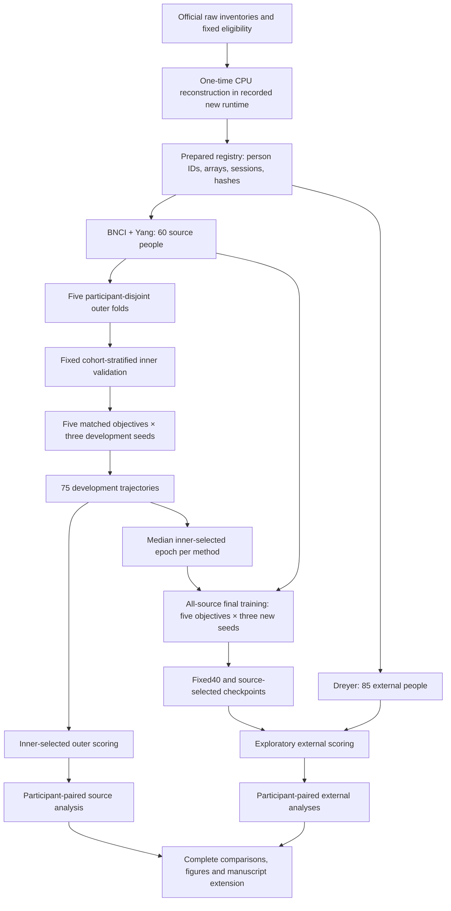

# Paper 1: participant–class risk and spectral consistency on school HPC

Protocol version: `paper1-source-risk-v1-20261023`.

This package tests a specific method hypothesis using a matched five-method
experiment: does emphasizing high-loss source participant–class groups improve
the weaker-class recall of held-out participants, and does within-trial spectral
consistency add a measurable increment? The experiment separates training
objective, checkpoint selection, and source-cohort composition. Its outputs will
extend Paper 1; they do not replace the completed eligible-v3 results or the
earlier Q1–Q16 evidence.

The current deliverable is code and a prespecified analysis. New HPC effect
sizes, p values, runtime measurements, and manuscript claims await completed
training and evaluation. The corresponding manuscript insert is in
[MANUSCRIPT_EXTENSION.md](MANUSCRIPT_EXTENSION.md); the detailed statistical
specification is in [ANALYSIS_PLAN.md](ANALYSIS_PLAN.md), and verified related
work is in [LITERATURE_AND_NOVELTY.md](LITERATURE_AND_NOVELTY.md).

## 1. Hypotheses and contribution targets

The primary hypothesis concerns the combined `tail_consistency` objective versus
balanced empirical risk minimization (`erm`) on participant-level weaker-class
recall in nested source evaluation. Three controlled comparisons then isolate
the proposed components and compare them with an established robust-risk
approach. Balanced accuracy and both class recalls accompany W to identify any
trade-off between class balance and overall discrimination.

The design can support the following contributions if the completed evidence
does so:

| Contribution target | Required evidence | Scope of a supported statement |
|---|---|---|
| Participant–class risk targeting | Combined objective versus ERM on the prespecified nested W endpoint | An improvement within this registered, source-only comparison, with its effect and interval |
| Increment beyond robust-risk optimization | Combined objective versus GroupDRO | An advantage over the implemented, matched GroupDRO baseline |
| Contribution of each component | Combined objective versus tail-only and consistency-only | Incremental benefit beyond either component; a highest mean alone is not an interaction test |
| Separation of objective and selected duration | Fixed-40 and source-selected external checkpoints from the same final trajectories | Whether an objective's observed behavior persists at a common duration |
| Participant-level benefit and concentration | Full per-person W, balanced accuracy and class recalls, averaged over seeds | How widely gains or losses are distributed across the registered people |
| Reusable experimental execution | Saved updates, checkpoints, evaluation shards and completion records | Recovery without repeating completed trajectories or silently omitting failures |

Source-only learning, consistency regularization, spectral information and
GroupDRO already have prior art. The testable contribution is their particular
participant–class formulation and controlled evaluation, not a claim of a new
risk theory or blanket superiority over domain-generalization algorithms.

## 2. Data and numerical version

The school project is prepared from raw data. The transport manifest binds the
official raw sources and original object identities; the CPU preparation stage
then reconstructs the eligible-v3 signal contract in an isolated, recorded
runtime. Already processed arrays may be imported only through the separately
documented verified-cache route.

| Dataset | Role | Eligible participants | Eligible trials | Acquisition inventory |
|---|---|---:|---:|---|
| BNCI2014-001 | Source | 9 | 2,592 | 18 frozen MAT files |
| Yang2025 two-class subset | Source | 51 | 30,591 | v5 inventory: 312 archive members, including 306 raw/event members |
| Dreyer2023 | Exploratory external scoring | 85 | 6,800 | 174 frozen EDF objects before the established montage eligibility rule |

All 60 source participants are retained. The pre-existing Dreyer montage
exclusions, including A17 and A41, are inherited from the input contract and are
not reconsidered after observing model outcomes. Trial identities include
dataset, participant, session, run and trial, so a physical trial cannot silently
appear in two roles. The raw transport is approximately 71.34 GB; actual disk
requirements must include raw files, reconstructed caches, prepared arrays,
checkpoints and temporary writes. The package's manifest supplies exact object
sizes and hashes rather than relying on this rounded estimate.

The input contract contains three views in broad/mu/beta order, 18 genuinely
shared scalp channels, 160 Hz sampling, and 320 samples per trial. It retains the
established 18-channel common-average reference; broad 8–30 Hz, mu 8–13 Hz and
beta 13–30 Hz bands; frozen SOS and initial-state coefficients; odd-padding
length 27; and the analysis-anchor window [0.5, 2.5) s. The frozen Yang clock and
eligibility rule uses the event anchor shifted by 1.5 s, corresponding to the
marker-relative [2, 4) s window. No event rule is selected using this study's
classification results.

Each channel is centered within its own trial and view. All three views use the
same scale: the broad view's root-mean-square amplitude over that trial's 18
channels and 320 samples. This produces dimensionless arrays without estimating
normalization parameters across participants or target trials. The exact
implementation is the vendored eligible-v3 preprocessing code. The new CPU
runtime is NumPy 2.2.6 and SciPy 1.15.3, recorded separately from the historical
runtime. New prepared arrays receive a new recorded fingerprint. Reusing the
signal definition does not assert bitwise equality with old-runtime arrays or
permit combining old and new model results as one experiment.

Preparation is performed once per participant and can resume. Training reads
prepared memory-mapped arrays and their metadata; it does not download raw EEG,
install dependencies, or repeat signal preprocessing when a Slurm task starts.

## 3. Matched methods

All five methods share the same compact EEGNet-style implementation: 8 temporal
filters, depth multiplier 2, 16 separable-block outputs, temporal kernel length
64, dropout 0.25, and a two-class output. This is the package's direct PyTorch
implementation, not a claim of checkpoint equivalence with a historical
Braindecode model.

A batch contains four source participants from each cohort, both classes per
participant, and eight sampled trials per class: 128 trials in total. Cohort and
class allocation are matched across methods. Participant selection is without
replacement when the training cohort contains at least four people; the
specified replacement rule supports smaller synthetic checks. Participant and
trial RNG state is saved in checkpoints. All methods process the same three
views in a concatenated forward batch, including the same BatchNorm exposure.
Inference uses the broad view with the model in evaluation mode.

Let `ell_g` denote the mean broad-view cross-entropy of the observed
participant–class group `g`. `L_mean` is the average of the observed group means.
`L_tail` is the mean of the largest `ceil(0.5 × G)` group losses in the batch,
where `G` is the number of observed groups. Unobserved groups are not assigned
zero loss. `JS` is the temperature-1, three-view Jensen–Shannon divergence of
the same trial's predictive distributions; all branches retain gradients.

| Method | Objective |
|---|---|
| ERM | `L_mean` |
| GroupDRO | Source participant–class group-weighted risk, with the registered sampling correction |
| Tail | `0.5 L_mean + 0.5 L_tail` |
| Consistency | `L_mean + 0.1 JS` |
| Tail + consistency | `0.5 L_mean + 0.5 L_tail + 0.1 JS` |

GroupDRO starts from equal-cohort, equal-participant, equal-class prior weights.
Its exponential group-weight update uses eta 0.01. Inverse group-inclusion
probabilities correct the unequal frequency at which a participant from a small
or large cohort appears in a batch. The model gradient uses the pre-update
group weights. The exact equations and sampling probabilities are documented
in [LITERATURE_AND_NOVELTY.md](LITERATURE_AND_NOVELTY.md) and implemented in
`hpcmi/objectives.py`. Those weights and probabilities are part of the saved
optimization state.

Every trajectory uses Adam with learning rate 0.001, weight decay zero, 40
epochs and 128 optimizer updates per epoch. The baseline schedule has a constant
learning rate and no scheduler; its checkpoint records `scheduler=null`.
Automatic mixed precision is disabled. Each completed trajectory contains
5,120 optimizer updates; the full 90-trajectory matrix contains 460,800 planned
updates. These are protocol counts, not evidence that any update has occurred.
The fixed coefficients and methods are not selected by external outcomes.

## 4. Source selection and evaluation matrix

Whole-person outer folds are stratified by source dataset, with split seed
20261023. Within each outer training pool, 20% of participants in each cohort,
rounded upward, form a fixed inner validation set. At least two training
participants remain in each source cohort. All methods and seeds use the same
partitions. Each source person appears in one outer test fold, while all of
their sessions stay together.

| Phase | Methods | Folds | Seeds | Fits | Model-selection information |
|---|---:|---:|---:|---:|---|
| Nested source development | 5 | 5 | 20261031–20261033 | 75 | Inner source participants only |
| Final source training | 5 | All source people | 20261101–20261103 | 15 | Median of the method's 15 inner-selected epochs |

The inner criterion is W: calculate each person's smaller class recall, average
people within each source cohort, and then give the cohorts equal weight. Ties
select the earlier epoch. Outer source scores never select a checkpoint.

After all 75 development tasks have completed, each method's 15 inner-selected
epochs determine an integer median epoch. Final fits train on all 60 source
people to epoch 40 and preserve both that selected checkpoint and the fixed-40
checkpoint. Scoring those two checkpoints does not add 15 more fits. Dreyer
event/class metadata supports the established mapping and labels support
scoring. They do not fit model parameters, normalization statistics or
BatchNorm, or choose training duration.

**Figure 1 draft caption.** Prespecified training and evaluation workflow.
Source-inner participants select epochs; source-outer participants and the
external cohort are used for scoring. The external cohort supplies no model-
selection feedback. Each final trajectory supplies two evaluation checkpoints.

## 5. Analysis and reporting

The primary source contrast is combined objective minus ERM on W. W is the
minimum of the two person-specific class recalls, calculated within seed before
averaging the three seeds. Balanced accuracy is their mean. Source estimates
give equal weight to cohorts and then to people; external estimates give equal
weight to people. Seeds and trials are not independent participant replicates.

The four secondary comparisons per domain are combined minus GroupDRO, tail,
and consistency on W, and combined minus ERM on balanced accuracy. The fixed
four-test family receives Holm correction. Paired participant bootstrap
intervals use 10,000 replicates, stratified by source cohort where applicable.
Two-sided paired sign-flip tests enumerate at most 16 participants and otherwise
use 100,000 Monte Carlo draws with a plus-one correction. The deterministic
resampling seeds and all contrast directions are saved. Full specifications and
conditional-inference assumptions are in [ANALYSIS_PLAN.md](ANALYSIS_PLAN.md).

Dreyer remains exploratory because historical exposure is known. The nested
source folds share training participants across folds, so participant resampling
does not establish independent training-set replication. These boundaries are
reported once alongside the analysis rather than repeated as rhetorical
qualifiers throughout the manuscript. Complete adverse and null contrasts are
retained in the same tables as gains.

### Prespecified result tables — populate from completed saved outputs only

**Table 1. Method-level performance.** Values are participant aggregates over
three seeds; “Pending” denotes results that do not yet exist.

| Domain | Method | W (%) | Balanced accuracy (%) | Left recall (%) | Right recall (%) | People / seeds |
|---|---|---|---|---|---|---|
| Nested source | ERM | Pending | Pending | Pending | Pending | 60 / 3 |
| Nested source | GroupDRO | Pending | Pending | Pending | Pending | 60 / 3 |
| Nested source | Tail | Pending | Pending | Pending | Pending | 60 / 3 |
| Nested source | Consistency | Pending | Pending | Pending | Pending | 60 / 3 |
| Nested source | Tail + consistency | Pending | Pending | Pending | Pending | 60 / 3 |
| Dreyer fixed40 | ERM | Pending | Pending | Pending | Pending | 85 / 3 |
| Dreyer fixed40 | GroupDRO | Pending | Pending | Pending | Pending | 85 / 3 |
| Dreyer fixed40 | Tail | Pending | Pending | Pending | Pending | 85 / 3 |
| Dreyer fixed40 | Consistency | Pending | Pending | Pending | Pending | 85 / 3 |
| Dreyer fixed40 | Tail + consistency | Pending | Pending | Pending | Pending | 85 / 3 |
| Dreyer source-selected | ERM | Pending | Pending | Pending | Pending | 85 / 3 |
| Dreyer source-selected | GroupDRO | Pending | Pending | Pending | Pending | 85 / 3 |
| Dreyer source-selected | Tail | Pending | Pending | Pending | Pending | 85 / 3 |
| Dreyer source-selected | Consistency | Pending | Pending | Pending | Pending | 85 / 3 |
| Dreyer source-selected | Tail + consistency | Pending | Pending | Pending | Pending | 85 / 3 |

**Table 2. Registered paired comparisons.** Repeat this five-row layout for the
nested source, external fixed40 and external source-selected domains.

| Contrast | Endpoint | Difference (pp) | 95% CI (pp) | Raw p | Holm p | Improved / declined / tied |
|---|---|---|---|---|---|---|
| Combined − ERM | W | Pending | Pending | Pending | Separate primary or exploratory contrast | Pending |
| Combined − GroupDRO | W | Pending | Pending | Pending | Pending | Pending |
| Combined − Tail | W | Pending | Pending | Pending | Pending | Pending |
| Combined − Consistency | W | Pending | Pending | Pending | Pending | Pending |
| Combined − ERM | Balanced accuracy | Pending | Pending | Pending | Pending | Pending |

**Table 3. Execution completeness.** Report completed/expected trajectories,
actual optimizer updates, missing evaluations, source-selected epochs, elapsed
compute time, and checkpoint-recovery counts. No missing task is entered as
zero performance. Compute measurements must come from Slurm and worker records,
not from allocation requests.

**Figure 2 plan.** Forest plots of every registered W/BA contrast, with source
and external domains in separate panels. Display signed effects and intervals
on a common percentage-point scale.

**Figure 3 plan.** All participant-level combined-minus-ERM W and BA changes,
ordered by fixed participant ID within cohort. Use the same participants in
both panels; do not rank or omit people to accentuate favorable cases.

**Figure 4 plan.** Source-inner selection curves and chosen epochs, followed by
paired fixed40/source-selected external summaries. Keep development evidence
separate from external outcomes; these plots do not retrospectively change the
selection rule.

## 6. School HPC execution and recovery

The default project directory is under
`/public/home/zhuziyuan/projects/paper1-risk-v1`. The account is `zhuziyuan`
and the current partition is `hpc_gpu` following the 24 October operational
revision. Independent method/seed/fold tasks request `gpu:1`, 16 CPUs and 128 GB memory each,
inside one enclosing Slurm allocation. It requests two GPUs, 32 CPUs and
256 GB memory and runs at most two independent single-GPU fits concurrently;
no training array or child sbatch is submitted. Download, CPU preparation,
GPU checks, all fits and analysis are stages of that same job.
Availability, GPU type and node resources come from the actual Slurm allocation.
The initial plan targeted A100 devices in `hpc_gpu1`; the new screenshot does
not identify the GPU type. The prior `gpu3` anomaly remains in historical
records; the new partition request does not guess node names. This resource
revision does not change scientific inputs, task definitions or checkpoints.

Training uses the Slurm-provided visible device as `cuda:0`. PyTorch has four
intra-op threads, one inter-op thread, and no DataLoader subprocesses in the
baseline configuration. The package applies its BLAS thread caps before Python
imports. Raw transport and dependencies are staged before GPU submission.
Python 3.12.3, PyTorch 2.5.1+cu121 and NumPy 2.2.6 were reported for the existing
school interpreter; the actual launch records its versions. The cu121 build
tag alone establishes neither the installed driver nor an nvcc version. The
existing shared environment is not upgraded, and raw preprocessing uses its
separate dependency environment.

Before submitting, the launcher creates absolute shared-storage log paths.
Shell output identifies job, task, host and time; unbuffered Python output
records actual phases, optimizer steps and processed samples. Training state
is saved on a 180-second schedule and at epoch boundaries, with two generations.
It includes model weights, Adam state, epoch and in-epoch step, sampler RNG and
cursor, Python/NumPy/Torch RNG state, objective state, selected/best weights,
validation history and the AMP state when applicable. Temporary writes use
same-directory files, file `fsync`, and `os.replace`.

USR1 requests a checkpoint and a resumable exit. The wrapper attempts a Slurm
requeue where allowed; the same launcher also resumes manually. TERM/INT from
user cancellation save state without requesting automatic revival. Completed
tasks are skipped, and an independent failure does not cancel the other array
tasks. Evaluation saves session/run shards, so a scoring interruption resumes
from saved model weights and completed shards rather than training again.

GitHub synchronization runs separately, approximately every 180 seconds. The
launcher prompts for a repository-authorized token before training; the secret
stays outside scientific outputs and published summaries. Network failures,
rate limits and upload retries affect the monitor, not optimizer execution.
The monitor publishes this project's status path and completed statistical
summaries, never raw EEG or credentials. Persistent checkpoints and results stay
on `/public/home`; `/tmp` is used only for replaceable data.

The first allocated GPU check is a small forward/backward/save/resume exercise.
It establishes local execution compatibility, not scientific results. Routine
resumption reuses that setup and the existing checkpoints instead of repeating
full tests, raw-data scans or pilot training. Cross-device or software-version
changes are recorded; recovery does not depend on matching an old physical GPU
UUID or claim untested cross-runtime bitwise identity.

## 7. Completion and manuscript update

The study is complete when all 75 development and 15 final trajectories have
their required evaluations, every registered participant and seed is represented,
and the saved-output analyses finish. A running Slurm allocation or growing
elapsed time alone is not completion evidence. Failure records and earlier
checkpoints remain part of the experiment history.

Manuscript updates then use the complete tables to select precise, supported
contribution statements. Report the strongest established effects prominently
and keep direct comparator results available in the same evidence chain.
Methodological changes after this version starts are assigned a new experiment
version; execution repairs preserve the existing scientific identity and fits.
