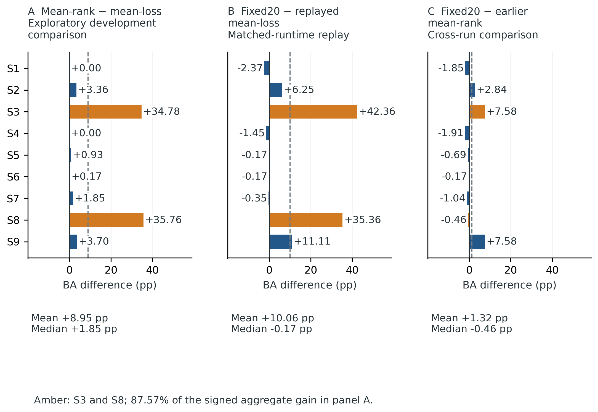
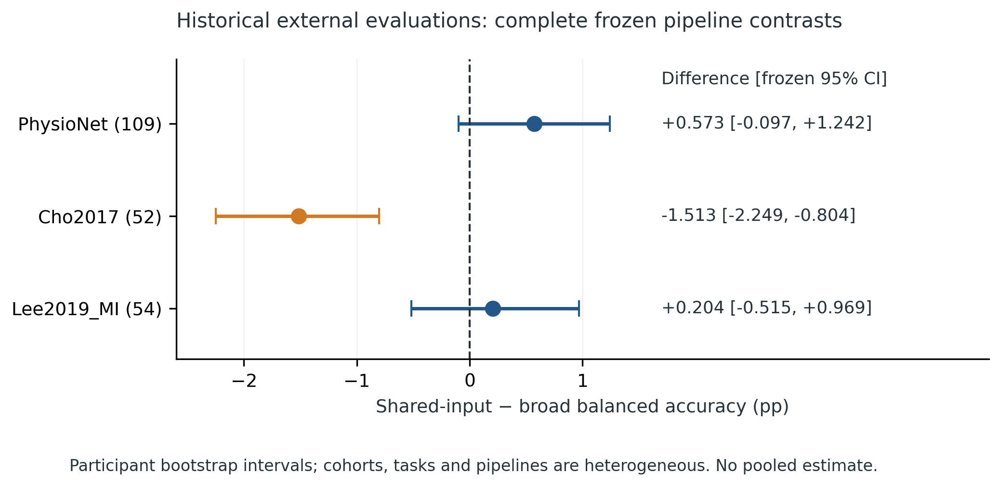
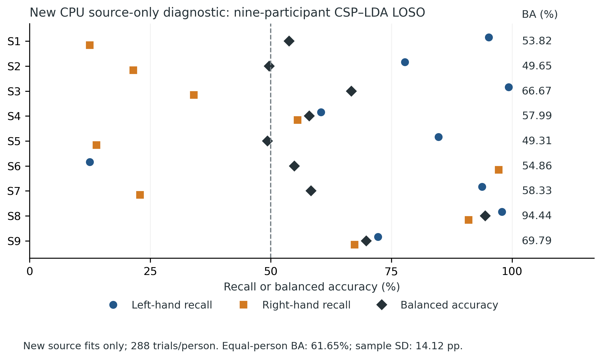

# Reliability of source-only training-duration selection in motor-imagery EEG decoding

Ziyuan Zhu

College of Artificial Intelligence Medicine, Chongqing Medical University, Chongqing, China

Correspondence: zzy2630816871@gmail.com. ORCID: https://orcid.org/0009-0005-1153-4926

Postal address: Jinyun Campus, Chongqing Medical University, No. 61, Daxuecheng Middle Road, Shapingba District, Chongqing 401331, China

**Research work version — not submission-ready.** This document reports audited historical observations and a newly executed source-only CSP diagnostic. The proposed common-montage neural experiment and independent target evaluation have not been executed. Planned methods are identified separately; they are not completed findings. Historical author approval does not constitute approval of this new version.

## Abstract

Source-only model selection avoids fitting a decoder to a new person's recordings, but its reliability also depends on the people used for validation and the acquisition setting in which it is deployed. We audited a motor-imagery EEG research programme to distinguish developmental recovery from evidence that a selection rule generalizes. Trial-level predictions and source-validation curves were reaggregated without modifying frozen results. In nine BNCI2014_001 participants, an exploratory mean-rank duration rule increased four-class balanced accuracy from 33.72% to 42.67%; two participants contributed 87.57% of the aggregate gain. Fixed 20-epoch training exceeded a separate matched-runtime replay of the earlier loss-selected schedules by 10.06 percentage points, yet improved only four of nine people. Historical binary shared-minus-broad complete-pipeline differences were +0.573 percentage points on PhysioNet, −1.513 on Cho2017 and +0.204 on Lee2019; unequal schedules and other pipeline differences prevent attribution to spectral sharing. A newly frozen, source-only binary CSP diagnostic obtained 61.65% leave-one-person-out balanced accuracy and 63.04% training-set resubstitution, with pronounced participant-level class-recall asymmetry. These are retrospective source observations, not independent target confirmation. We specify a common 19-channel, architecture-by-duration-rule evaluation for a candidate first-use motor-imagery acquisition cohort, retaining participant tails, adverse outcomes and all six planned cells. That experiment remains unexecuted. The existing evidence motivates a focused test of selection reliability; it establishes neither a generally superior duration rule nor a physiological mechanism or deployment benefit.

## Introduction

A cross-subject EEG decoder must operate on recordings that differ in signal scale, spatial covariance, artifacts and task execution. Training-duration selection is part of that decoder's specification. A validation rule can be source-only in every fit while still being developed after inspecting outcomes on the same benchmark. These are different safeguards: split-level separation prevents fitting leakage, whereas independent evaluation tests whether a decision made during development survives a new setting.

The nine-person BCI Competition IV dataset 2a, distributed as BNCI2014_001, makes this distinction concrete [1]. A large cohort-mean change can arise from a small number of recoveries, especially when an earlier schedule stopped after very few epochs. Model-selection overfitting and uncertainty in brain-decoder evaluation are established concerns [2,3]. Domain generalization benchmarks likewise treat the selection procedure as part of the evaluated algorithm [4]. Reproducible BCI benchmarking [5], SpeechBrain-MOABB [6] and recent EEG protocol work [7] already address pipeline tuning, participant subsets and random initialization. Repeating these principles is not, by itself, a new contribution.

Our question is narrower: **how reliable are source-only training-duration decisions under participant heterogeneity and cross-dataset shifts?** Reliability is assessed through a specified rule contrast, its participant-level distribution and a target-information contract. A mean effect, the number of people helped and the frequency of nearly one-class predictions address different aspects of performance. They cannot be reduced to the ordering of a few means.

EEGNet and CSP provide established, interpretable implementation anchors rather than novel architectures [8–10]. Recent domain-generalization and zero-calibration work proposes more elaborate transferable representations [11,12]. Such studies must be compared according to which target recordings, labels and cohort members were available during training or adaptation. For example, zero calibration for an individual does not imply that no other labelled participants from the target cohort entered development. We do not rank our archived pipelines against those algorithms or claim state-of-the-art performance.

This work version separates three evidential roles. First, the historical programme supplies hypothesis-generating results and separately frozen external contrasts. Second, a new CPU experiment supplies traceable source CSP diagnostics that were missing from an earlier report. Third, a locked design defines the neural comparison still needed on a task-matched candidate first-use cohort. Its potential contribution is empirical evidence about selection reliability under that design. It has not yet been obtained.

## Methods: completed evidence and analyses

### Historical evidence and evaluation units

The historical programme contains internal four-class BNCI evaluations and separate binary transfer studies on PhysioNet [13], Cho2017 [14,15] and Lee2019 [16,17]. These studies have already been inspected repeatedly and are treated as development or historical external evidence in this redesign. They cannot be presented as previously unseen tests of a newly developed rule.

The audit read and hashed 17,091 archived files, parsed 4,515 JSON files and 9,620 CSV or compressed CSV files, and decoded 336 text files. Parsing coverage is not a claim that every line received independent scientific review. Critical protocols, manuscript claims, frozen contracts and supplied scientific reviews were assessed separately. Seven main prediction tables were reaggregated from trial-level class decisions into participant-by-seed balanced accuracy and then participant means. The nine original source-selected schedules were reconstructed from 1,440 validation-curve rows. Artifact identities, probabilities and prediction argmax consistency were checked at the recorded evaluation grain; repeated model and seed rows were not counted as additional people.

Balanced accuracy is the unweighted mean of class recalls. The four-class internal and binary external scores have different label spaces and chance levels. All effect differences are reported in percentage points. Historical uncertainty procedures were replayed using their original draws and seeds; p-values and confidence intervals were preserved rather than replaced by a preferred retrospective test. New sensitivity calculations are labelled as such. Participant averaging precedes cohort averaging. Overlapping source partitions and repeated trials do not increase the independent participant count.

### Developmental duration comparisons

The mean-loss development condition (Q5) and mean-rank follow-up (Q8) excluded both sessions of the held-out participant from fitting and duration selection. They used four-class decoding and three final random initializations per participant. The follow-up arose after earlier results on the same nine people. It is therefore exploratory at the programme level despite source-only selection within each split.

The fixed-duration control and the separate matched-runtime replay of historical loss-selected epochs (Q13) used the same recorded later runtime, raw-data and final-seed policies. The replay did not reselect the loss schedule under that runtime. A comparison of fixed 20 epochs with the older rank predictions is additionally provided as a cross-run description. The older configuration declares a CPU device, whereas its runner automatically selects CUDA if available; an authenticated effective-runtime manifest was not recovered. We do not infer either verified runtime equality or a definite CPU-versus-GPU contrast from that discrepancy.

### Historical complete-pipeline transfer

The earlier PhysioNet evaluation (Q14) used 22 channels, 480 time points at 160 Hz and cue-relative [0.5,3.5) s epochs. Its broad and shared pipelines selected 18 and 17 epochs, respectively. The later Cho2017/Lee2019 transfer experiment (Q15) used 21 channels, 320 time points and [0.5,2.5) s epochs after fixed native-context processing and common-average referencing, with broad/shared durations of 14/19 epochs. Fifteen source fits were recorded, with zero target fits. Ground-truth labels were used for scoring; event/class metadata supported eligibility and mapping. Target data did not select schedules or update model parameters.

These are complete-pipeline contrasts. Band inputs, one-view versus two-view computation, shared BatchNorm exposure, duration and preprocessing differ. They cannot isolate the effect of frequency decomposition or parameter sharing. The four source-validation groups contained 2/2/2/3 participants with equal fold weighting. They were frozen before target inference, but represent one arbitrary grouping whose sensitivity was not prospectively assessed. The three external results are reported separately rather than pooled as an identical 215-person experiment.

### New source CSP diagnostic

A separate CPU preanalysis was publicly committed before execution. Eighteen official BNCI MATLAB files, totaling 779,873,919 bytes, matched the archived SHA-256 records. The new diagnostic reused the frozen 21-channel binary source preprocessing and all binary hand trials from both sessions, including provider flags. Each participant contributed 288 trials, 144 per class; the complete source set contained 2,592 trials.

A fixed 21-to-20 common-average-reference basis preceded four-component CSP, log average-power features, source-fitted standardization and linear discriminant analysis. Nine leave-one-person-out fits each used 2,304 trials from eight people and scored 288 trials from the ninth. A tenth fit used all 2,592 trials and was scored on those same training trials. This last score is resubstitution, not validation. Actual fit inputs, partitions, labels, checkpoints, predictions and runtime versions were hashed. The current libraries differ from the historical run. The original model was not deserialized or replayed; numerical agreement cannot retrospectively supply missing provenance for that model.

An independent validator reconstructed trial labels from the raw source files and recomputed stored confusion matrices and scores. A separate review checked partitions, output identities and hash bindings. Input numerical replay reused the frozen transform, so it does not constitute a wholly independent alternate preprocessing implementation. Ten new source CSP fits, zero new neural fits and zero target fits were completed. No new target prediction, target centering or posthoc label inversion was performed.

## Results: completed analyses

### Development gains were concentrated

Mean-rank versus mean-loss balanced accuracy was 42.67% versus 33.72%, an exploratory mean increase of 8.95 percentage points. The median increase was 1.85 points; seven participants improved and two were unchanged. S3 and S8 supplied 87.57% of the signed aggregate increase (Fig 1). The archived participant-bootstrap interval was [1.048,19.959] points. The spread and concentration limit any inference about a typical previously unseen person.

Fixed 20-epoch balanced accuracy was 43.99%, compared with 33.92% for the later matched-runtime replay of the historical loss schedule. Its mean difference was +10.06 points and archived bootstrap interval [0.675,21.528], but the median was −0.174 points: four participants improved and five worsened. The exhaustive sign-flip sensitivity was p=0.125. Mean recovery and majority benefit are not interchangeable conclusions.

A new saved-prediction description comparing fixed 20 epochs with the older rank follow-up gave +1.32 points on average, median −0.463 points, with three improved and six worsened participants. This does not establish superiority, equivalence or a matched-runtime ranking of the rules. Earlier robustness controls retained no corrected established gain; their null and adverse results remain in the supplement and archive.

### Historical transfer provided inconsistent pipeline effects

| Historical cohort | Participants | Broad BA (%) | Shared BA (%) | Shared − broad (pp) | Frozen 95% interval (pp) |
| --- | ---: | ---: | ---: | ---: | --- |
| PhysioNet | 109 | 61.815 | 62.388 | +0.573 | [−0.097,+1.242] |
| Cho2017 | 52 | 59.824 | 58.310 | −1.513 | [−2.249,−0.804] |
| Lee2019 | 54 | 65.512 | 65.716 | +0.204 | [−0.515,+0.969] |

Table 1. Archived binary complete-pipeline contrasts, reaggregated from stored predictions. Intervals use the original participant-bootstrap procedures. PhysioNet and the later two cohorts use different frozen pipelines and windows; the table is not a pooled replication analysis.

PhysioNet superiority was not established by its archived sign test (p=0.064464). Cho2017 was an adverse shared-minus-broad result, with a two-cohort Holm-adjusted Monte Carlo p=0.000100; Lee2019 was uncertain, with p=0.603670. Lee2019 uncertainty does not establish equivalence. Fig 2 displays each frozen interval separately.

The audit also identified a floating-point tie sensitivity in the PhysioNet sign count. A stored difference of approximately −1.11×10⁻¹⁶ was negative under the original exact-zero rule. A new retrospective sensitivity using a numerical tie tolerance changed the count from 63/43/3 improved/worsened/tied to 63/42/4, giving p=0.050442. The mean, interval and frozen primary p-value remain unchanged; neither test meets 0.05. This finding motivates explicit numerical tie handling, not replacement of the original test.

### CSP source scores concealed class-recall asymmetry

The new binary source CSP experiment yielded 61.65% equal-participant leave-one-person-out balanced accuracy, with a participant sample standard deviation of 14.12 points. Participant scores ranged from 49.31% to 94.44%. All-source training resubstitution was 63.04%; its apparent proximity to the leave-one-person-out mean is not an estimate of external generalization.

Class recalls were strongly asymmetric for several participants (Fig 3). For S1, left recall was 95.14% and right recall 12.50%, with 91.32% of predictions assigned left. For S6, left recall was 12.50% and right recall 97.22%, with 92.36% of predictions assigned right. Neither crossed the new prospective 95% dominance threshold; the diagnostics are reported without retrospectively relabelling this threshold as observed collapse. The direction of source asymmetry also varied between people.

Archived external CSP predictions were left-dominant: 92.07% of Cho2017 trial-pooled predictions and 83.21% of Lee2019 predictions were left, with equal-person balanced accuracy of 51.99% and 52.77%. These historical target outputs were not regenerated. Source discriminability and external output bias coexist, but do not identify their cause. Sensor montage, scale convention, covariance shift, artifacts and implementation uncertainty remain plausible contributors. The audit did not establish physical voltage calibration or exclude every preprocessing error. No failure explanation is asserted as unique.

## Locked design: independent evaluation not yet executed

### Candidate cohort and eligibility

Dreyer2023 is the conditional primary candidate [18]. Its 87 participants belong to one acquisition programme with A/B/C origin strata, not three independent dataset replications. The first two acquisition runs provide nominally 80 hand-imagery trials per person under sham feedback. Subsequent individually adaptive online runs are outside the primary design. Two participants, A17 and A41, have unresolved provider-reported electrode-order corruption and are excluded by the locked montage rule. The remaining 85 are an eligibility ceiling, not an observed final sample. Other provider quality flags remain included unless the prespecified signal-only technical guards fail.

The original 27-channel montage lacks three channels required by the old 21-channel checkpoint. New source models must therefore be trained on 19 actual common electrodes; truncating or interpolating the old checkpoint is not permitted. A bounded access pilot verified two acquisition EDF files and the corresponding first-run BDF, event identities, common channel labels and pre-cue numerical scale consistency. It did not prove original-GDF equivalence or complete the whole-cohort raw audit. A derivative sidecar/raw-paper hardware-filter discrepancy remains unresolved. Author confirmation of no previous model evaluation on this cohort, duplication and reuse checks, whole-cohort eligibility and conversion provenance remain required.

The planned [0.5,2.5) s crop overlaps a visual feedback display beginning 1.25 s after the cue. It is an instructed MI-containing task window, not evidence of artifact-free cortical imagery. Changing it after target results would create a different study.

### Source-only factorial comparison

The locked specification crosses two pipelines—Broad EEGNet and shared μ/β EEGNet—with fixed 20 epochs, mean validation loss and mean within-fold loss rank. Source persons, real 19-channel montage, common-average reference, native-trial context, resampling, crop, labels, candidate durations and final-seed strategy are common. Forty-epoch source trajectories in four fixed groups select the earliest loss/rank minimum with equal fold weighting. Three fresh all-source seeds are planned for every cell; byte-identical schedules may reuse explicitly recorded identical checkpoints without inflating fit counts.

Eight inner trajectories and 18 nominal final fits give 26 nominal new neural fits. This is an execution budget, not a completed count. Shared training concatenates two fixed band views in the batch dimension and averages logits before cross-entropy; target inference uses evaluation mode without BatchNorm updates. Fixed20 shared-minus-broad controls duration, but still compares complete pipelines with unequal view exposure and computation. Epoch equality does not imply equal FLOPs, energy or optimizer information content. No target fitting, normalization fitting, model selection or threshold tuning is permitted.

### Endpoints and uncertainty

The sole primary contrast is Broad mean-rank minus Broad mean-loss equal-person balanced accuracy, averaging final seeds within person. A two-sided paired t test and 95% t interval are prespecified, with participant-bootstrap sensitivity. Rejection at 0.05 opens a three-contrast Holm family: Broad fixed20 minus loss, Broad fixed20 minus rank, and Shared fixed20 minus Broad fixed20 [19]. Estimates and adverse results are retained regardless of the gate. Ordinary secondary 95% intervals are explicitly unadjusted; simultaneous conservative intervals are also planned. No equivalence or noninferiority margin has been justified.

Class recalls, mean seed-wise prediction dominance, benefit/harm counts, tail performance and compute costs accompany the mean. Source grouping sensitivity is registered but optional and currently disabled. Under an illustrative paired-difference standard deviation of 10 points, n=85 and 80% power, the two-sided primary detectable difference is about 3.07 points. This planning assumption is not a target-derived variance estimate or a claim of adequate power for smaller effects. The finalized eligibility count will determine attainable precision.

## Discussion

The historical programme supports concern about selection reliability more strongly than it supports a preferred selector. A rank rule recovered two poorly performing development cases, but those cases supplied most of the aggregate change. Fixed-duration training produced a larger mean than a replayed historical schedule while slightly worsening the median participant. These findings do not conflict: the mean summarizes magnitude, whereas the median and benefit count summarize different features of the same distribution. Reporting all three prevents a few recoveries from being mistaken for widespread improvement.

The external evidence concerns selected pipelines. A shared-input disadvantage on Cho2017 deserves the same prominence as an uncertain positive estimate on Lee2019. Neither the small PhysioNet mean difference nor the Lee2019 interval supports a broadly transferable sharing advantage. Existing source-only fits, freeze records and independent score audits establish that these outputs are traceable; they do not turn a multi-factor contrast into a single-factor causal experiment.

The new CSP experiment adds reproducible source diagnostics with real inputs, weights and confusion matrices. It shows why above-chance average balanced accuracy is insufficient to characterize failure. Some participants had high recall for one class and very low recall for the other, and the favoured class was not constant. This makes a universal corrective label flip inappropriate. It also leaves open whether the external left bias reflects acquisition shift, source decision geometry, scale conventions or another unresolved implementation issue. Diagnostic traceability strengthens an observation; it does not supply a physiological explanation.

A first-use task-matched cohort would answer a different question from another analysis of familiar benchmarks. The planned architecture-by-rule design tests whether source-selected duration differences survive a new acquisition setting and whether duration-matched pipeline effects remain. It does not propose a new domain-generalization algorithm. The broader methodological practices—nested selection, person-level uncertainty, reproducibility and multi-seed reporting—have precedents [2–7]; the potential contribution lies in the specific locked test and its measured outcome. Independent confirmation is absent at present.

The descriptive BNCI physiological characterization (Q16) is retained mainly in Supporting Information. It uses baseline-relative μ/β power, 10 log10(Ptask/Pbaseline), with unequal baseline/task Welch segment counts. Mean signed laterality was negative and varied between people. Nine-person post-outcome rank associations, including ρ=0.6, are descriptive, have no p-values and lack external physiological replication. The physiological and decoder windows differ. Signed laterality is not absolute contralateral ERD; scalp topography is not cortical localization; association does not show a decoder's learned mechanism [20]. No physiological descriptor fed back into model development.

### Limitations

The original developmental cohort has nine repeatedly inspected people and overlapping source partitions. Historical rule comparisons include incomplete effective-runtime provenance; a replayed old schedule is not a newly selected rule under the later environment. Four fixed 2/2/2/3 source groups with equal fold weighting represent one design rather than an exhaustive assessment of grouping reliability. Existing broad/shared external contrasts remain confounded by duration and other pipeline components. The source CSP audit uses familiar participants and cannot explain a target failure by itself.

The candidate target route is only partially verified, and first use has not been author-confirmed. Derivative conversion and hardware-filter metadata require resolution; anonymized identifiers cannot prove absence of person overlap. Its sham-feedback acquisition and overlapping visual display restrict task interpretation. A/B/C are not independent dataset replications, and power for small effects may be limited even if all 85 eligible people remain. New neural training and target inference have not run. The study provides no clinical utility, online deployment, real-time validation, universal calibration-free guarantee or causal physiological mechanism.

## Conclusion

The completed evidence shows large but concentrated developmental duration gains, inconsistent historical complete-pipeline transfer and participant-level CSP class-recall asymmetry. It does not establish that mean-rank or fixed 20-epoch selection is generally superior. The completed Cho2017 shared-input pipeline had 1.513-percentage-point lower balanced accuracy than broad EEGNet. A new common-montage source-only experiment and genuinely first-use target evaluation are required to test reliability beyond these observations; neither has been completed in this work version.

## Data, code and declarations

Frozen historical predictions, contracts and validation evidence remain unchanged in the repository. The redesign branch contains the new source diagnostic, public preanalysis receipt, hypothesis and statistical plans, software tests and separate working manuscript. Raw EEG is obtained from the original providers and is not included in the repository. The exact source and candidate-target access records, licences, limitations and instructions accompany the work package. No new journal submission or formal release is claimed.

This is secondary analysis of public pseudonymized research recordings without new participant recruitment or access to direct identifying information. The author reports that approval or an exemption was not required for the historical secondary analysis; no institutional determination, approval number or formal exemption document is asserted. Provider ethical and consent descriptions remain the source of original-acquisition information. The planned cohort analysis requires its access terms and secondary-use context to be reviewed before execution.

The author reports no funding, no competing interests and no other human contributor to the historical paper. Roles include conceptualization, methodology, investigation, analysis, software, visualization and writing. Approval of the redesigned work version remains an author action. Publication costs would be paid by the author if a future submission is accepted; this is not a funding award.

AI tools assisted literature retrieval, software and analysis drafting, language revision, figure/artifact preparation and repository publication. The author has identified ChatGPT with GPT-6; historical model-version provenance is not independently authenticated for every interaction. The use was broader than grammar correction alone. Tools are not authors, and the author remains responsible for checking the source evidence, code, interpretation and final text. This disclosure accompanies the work version and will require alignment with the actual selected journal's policy before submission.

## References

1. Brunner, C.; Leeb, R.; Müller-Putz, G. R.; Schlögl, A.; Pfurtscheller, G. BCI Competition 2008 – Graz data set A. Official competition dataset description. 2008. https://www.bbci.de/competition/iv/desc_2a.pdf.

2. Gavin C. Cawley; Nicola L. C. Talbot. On Over-fitting in Model Selection and Subsequent Selection Bias in Performance Evaluation. Journal of Machine Learning Research. 2010;11:2079–2107. https://www.jmlr.org/papers/v11/cawley10a.html.

3. Gaël Varoquaux; Pradeep Reddy Raamana; Denis A. Engemann; Andrés Hoyos-Idrobo; Yannick Schwartz; Bertrand Thirion. Assessing and tuning brain decoders: Cross-validation, caveats, and guidelines. NeuroImage. 2017;145:166-179. https://doi.org/10.1016/j.neuroimage.2016.10.038.

4. Gulrajani, Ishaan; Lopez-Paz, David. In Search of Lost Domain Generalization. International Conference on Learning Representations (ICLR). 2021. https://iclr.cc/virtual/2021/poster/2998.

5. Jayaram, Vinay; Barachant, Alexandre. MOABB: trustworthy algorithm benchmarking for BCIs. Journal of Neural Engineering. 2018;15(6):066011. https://doi.org/10.1088/1741-2552/aadea0.

6. Davide Borra; Francesco Paissan; Mirco Ravanelli. SpeechBrain-MOABB: An open-source Python library for benchmarking deep neural networks applied to EEG signals. Computers in Biology and Medicine. 2024;182:109097. https://doi.org/10.1016/j.compbiomed.2024.109097.

7. Davide Borra; Elisa Magosso; Mirco Ravanelli. A protocol for trustworthy EEG decoding with neural networks. Neural Networks. 2025;182:106847. https://doi.org/10.1016/j.neunet.2024.106847.

8. Manuel Eder; Jiachen Xu; Moritz Grosse-Wentrup. Benchmarking brain–computer interface algorithms: Riemannian approaches vs convolutional neural networks. Journal of Neural Engineering. 2024;21(4):044002. https://doi.org/10.1088/1741-2552/ad6793.

9. Lawhern, Vernon J; Solon, Amelia J; Waytowich, Nicholas R; Gordon, Stephen M; Hung, Chou P; Lance, Brent J. EEGNet: a compact convolutional neural network for EEG-based brain–computer interfaces. Journal of Neural Engineering. 2018;15(5):056013. https://doi.org/10.1088/1741-2552/aace8c.

10. Ramoser, H.; Muller-Gerking, J.; Pfurtscheller, G. Optimal spatial filtering of single trial EEG during imagined hand movement. IEEE Transactions on Rehabilitation Engineering. 2000;8(4):441-446. https://doi.org/10.1109/86.895946.

11. Hongyi Zhi; Tianyou Yu; Zhenghui Gu; Zhuobin Lin; Le Che; Yuanqing Li; Zhuliang Yu. Supervised Contrastive Learning-Based Domain Generalization Network for Cross-Subject Motor Decoding. IEEE Transactions on Biomedical Engineering. 2025;72(1):401-412. https://doi.org/10.1109/tbme.2024.3432934.

12. Minmin Miao; Wenliang Fu; Hong Zeng; Baoguo Xu; Wenbin Zhang; Wenjun Hu. Meta-Learning Enhanced Multi-Source Domain Adaptation for zero-calibration motor imagery EEG decoding. Journal of Neuroscience Methods. 2026;431:110742. https://doi.org/10.1016/j.jneumeth.2026.110742.

13. Schalk, Gerwin; McFarland, Dennis J; Hinterberger, Thilo; Birbaumer, Niels; Wolpaw, Jonathan R. EEG Motor Movement/Imagery Dataset. dataset. 2009. https://doi.org/10.13026/C28G6P.

14. Cho, Hohyun; Ahn, Minkyu; Ahn, Sangtae; Kwon, Moonyoung; Jun, Sung Chan. EEG datasets for motor imagery brain–computer interface. GigaScience. 2017;6(7). https://doi.org/10.1093/gigascience/gix034.

15. Cho, Hohyun; Ahn, Minkyu; Ahn, Sangtae; Kwon, Moonyoung; Jun, Sung Chan. Supporting data for "EEG datasets for motor imagery brain computer interface". dataset. 2017. https://doi.org/10.5524/100295.

16. Lee, Min-Ho; Kwon, O-Yeon; Kim, Yong-Jeong; Kim, Hong-Kyung; Lee, Young-Eun; Williamson, John; Fazli, Siamac; Lee, Seong-Whan. EEG dataset and OpenBMI toolbox for three BCI paradigms: an investigation into BCI illiteracy. GigaScience. 2019;8(5). https://doi.org/10.1093/gigascience/giz002.

17. Lee, Min-Ho; Kwon, O-Yeon; Kim, Yong-Jeong; Kim, Hong-Kyung; Lee, Young-Eun; Williamson, John; Fazli, Siamac; Lee, Seong-Whan. Supporting data for "EEG Dataset and OpenBMI Toolbox for Three BCI Paradigms: An Investigation into BCI Illiteracy". dataset. 2019. https://doi.org/10.5524/100542.

18. Pauline Dreyer; Aline Roc; Léa Pillette; Sébastien Rimbert; Fabien Lotte. A large EEG database with users’ profile information for motor imagery brain-computer interface research. Scientific Data. 2023;10:580. https://doi.org/10.1038/s41597-023-02445-z.

19. Holm, Sture. A Simple Sequentially Rejective Multiple Test Procedure. Scandinavian Journal of Statistics. 1979;6(2):65–70. https://www.jstor.org/stable/4615733.

20. G. Pfurtscheller; F.H. Lopes da Silva. Event-related EEG/MEG synchronization and desynchronization: basic principles. Clinical Neurophysiology. 1999;110(11):1842-1857. https://doi.org/10.1016/s1388-2457(99)00141-8.

## Figures

**Figure 1. Participant heterogeneity in historical source-duration comparisons.** Each bar is the saved, seed-averaged balanced-accuracy difference for one of nine BNCI participants. Panel A compares the exploratory mean-rank follow-up with the earlier mean-loss development condition. S3 and S8 contribute 87.57% of its signed aggregate gain. Panel B compares fixed20 with the matched-runtime replay of the historical mean-loss schedule. Panel C is a retrospective cross-run comparison of fixed20 with the earlier mean-rank run; the earlier effective runtime is not authenticated. Dashed lines show equal-participant means. These four-class development comparisons do not confirm a generally superior duration selector. pp, percentage points.

**Figure 2. Historical external complete-pipeline contrasts.** Points show the equal-participant shared-input minus broad balanced-accuracy difference, with the original frozen participant-bootstrap 95% confidence interval. The three cohorts are shown separately; their task definitions, eligible trials, and complete pipelines differ. The negative Cho2017 result and intervals spanning zero for PhysioNet and Lee2019_MI are retained. The comparison does not isolate spectral representation, parameter sharing, or training duration. No pooled cross-cohort estimate is shown.

**Figure 3. New CPU source-only CSP–LDA diagnostic.** Left-hand recall, right-hand recall, and balanced accuracy are calculated from the stored held-out predictions of nine newly executed leave-one-participant-out fits. All eight remaining participants contribute both sessions to each training fold; each held-out participant contributes 288 trials, balanced between classes. Equal-participant mean balanced accuracy is 61.65% with sample SD 14.12 pp. The separate all-source resubstitution fit is not plotted. These are new retrospective source fits in a recorded current runtime, not a replay of the archived external checkpoint, a prospective target-cohort result, or evidence for a superior neural method. The dashed line marks 50% and does not represent a participant-level statistical test.

